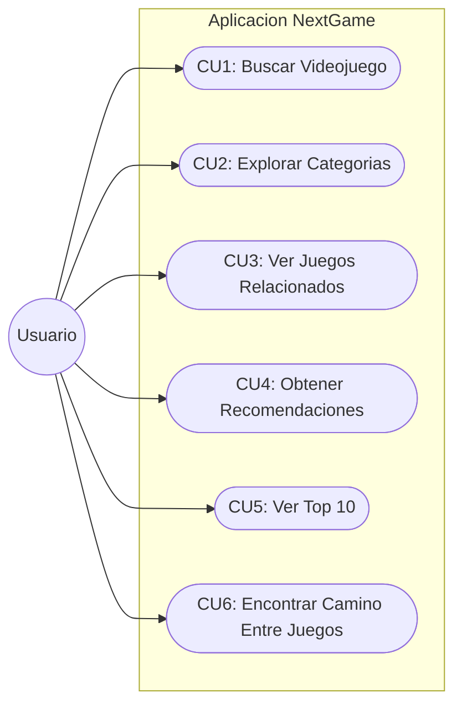

# Casos de Uso del Sistema — NextGame

En este documento explicamos como una persona interactua con la aplicacion paso a paso para realizar las acciones principales.

---

## 1. Diagrama General de Casos de Uso

---

## 2. Descripcion Detallada de Casos de Uso

### Caso de Uso 1: Buscar un videojuego por titulo

* **Actor:** Usuario
* **Precondicion:** El programa esta abierto y los juegos cargados desde el archivo JSON.
* **Flujo Principal:**
  1. El usuario elige la opcion `1. Buscar videojuego (Arbol AVL)` en el menu principal.
  2. El sistema le pide que escriba el titulo del juego.
  3. El usuario escribe el nombre (por ejemplo: "Witcher") y presiona ENTER.
  4. El sistema busca en el Arbol AVL y muestra en pantalla la informacion completa del juego (titulo, anio, generos, desarrollador y calificacion).
  5. El usuario presiona ENTER y vuelve al menu principal.
* **Flujo Alternativo:**
  * Si el juego no existe en el catalogo, el sistema muestra el mensaje: `No se encontraron videojuegos` y le permite volver al menu.

---

### Caso de Uso 2: Explorar categorias (Arbol General)

* **Actor:** Usuario
* **Precondicion:** El catalogo y el arbol de categorias estan inicializados.
* **Flujo Principal:**
  1. El usuario elige la opcion `2. Explorar categorias (Arbol General)`.
  2. El sistema muestra un submenu con opciones de visualizacion (ver arbol completo, recorrido por niveles BFS, recorrido en profundidad DFS o ver juegos de una categoria puntual).
  3. El usuario selecciona, por ejemplo, la opcion `1. Ver arbol completo`.
  4. El sistema dibuja en la consola la jerarquia con ramas (`|-- Genero \-- Juego`).
  5. El usuario revisa las categorias y presiona `0` para volver al menu principal.
* **Flujo Alternativo:**
  * Si elige una opcion que no esta en el menu, el sistema le avisa `Opcion invalida` y le vuelve a pedir que elija.

---

### Caso de Uso 3: Ver juegos relacionados (Grafo)

* **Actor:** Usuario
* **Precondicion:** El grafo de relaciones entre juegos esta armado con sus aristas.
* **Flujo Principal:**
  1. El usuario selecciona la opcion `4. Ver juegos relacionados (Grafo)`.
  2. El sistema le solicita el nombre del juego base.
  3. El usuario escribe el titulo (por ejemplo: "Grand Theft Auto V").
  4. El sistema busca el juego, consulta sus vecinos conectados en el grafo y muestra hasta 5 juegos que comparten la mayor cantidad de generos con el.
  5. El usuario presiona ENTER para continuar.
* **Flujo Alternativo:**
  * Si el usuario escribe mal el nombre o no existe el juego, el sistema avisa `No se encontro el juego especificado` y regresa al menu.

---

### Caso de Uso 4: Obtener recomendaciones

* **Actor:** Usuario
* **Precondicion:** El catalogo esta listo.
* **Flujo Principal:**
  1. El usuario selecciona la opcion `5. Obtener recomendaciones`.
  2. El sistema le pregunta: `¿Que juego te gusto?`.
  3. El usuario ingresa un titulo de su agrado.
  4. El sistema busca en el grafo los juegos relacionados y filtra los que tienen mejor calificacion (estrellas).
  5. Muestra una tarjeta destacada con las 3 mejores recomendaciones.
  6. El usuario presiona ENTER para volver.
* **Flujo Alternativo:**
  * Si el juego base no existe en la base de datos, el sistema muestra un mensaje de advertencia y no genera recomendaciones vacias.

---

### Caso de Uso 5: Ver el Top 10 de mejores juegos (Max-Heap)

* **Actor:** Usuario
* **Precondicion:** El Max-Heap tiene los 200 juegos cargados con sus calificaciones.
* **Flujo Principal:**
  1. El usuario selecciona la opcion `6. Ver Top 10 (Max-Heap)`.
  2. El sistema extrae del Heap los 10 videojuegos con mayor puntaje sin tener que ordenar todo el catalogo.
  3. Muestra una tabla numerada del 1 al 10 con el titulo y la nota de cada juego.
  4. El usuario revisa la lista y presiona ENTER para regresar al menu principal.

---

### Caso de Uso 6: Encontrar camino entre dos juegos (Dijkstra)

* **Actor:** Usuario
* **Precondicion:** El grafo y el catalogo estan cargados.
* **Flujo Principal:**
  1. El usuario selecciona la opcion `7. Encontrar camino entre juegos (Dijkstra)`.
  2. El sistema le solicita el juego de inicio (por ejemplo: "The Witcher 3").
  3. El sistema le solicita el juego de destino (por ejemplo: "Portal 2").
  4. El sistema ejecuta el algoritmo de Dijkstra y calcula la secuencia de transicion con menor costo acumulado.
  5. Muestra en pantalla la lista de juegos intermedios y el costo total de transicion.
  6. El usuario presiona ENTER para volver al menu principal.
* **Flujo Alternativo:**
  * Si alguno de los dos juegos no existe en el catalogo, el sistema avisa `No se encontro alguno de los juegos ingresados` y vuelve al menu.
