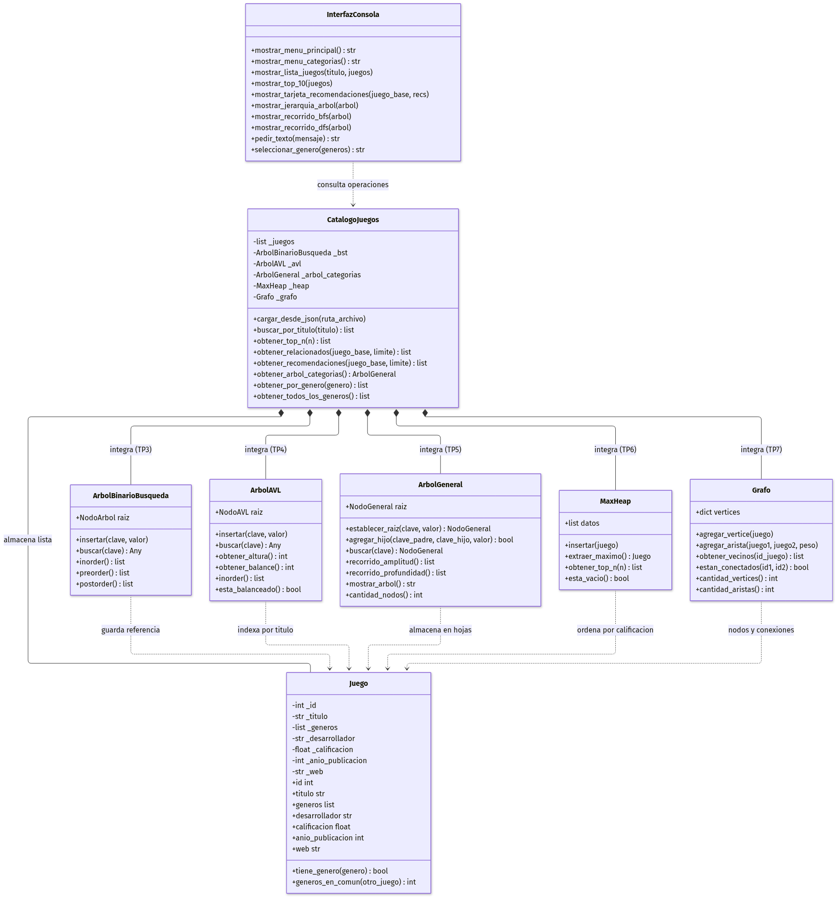
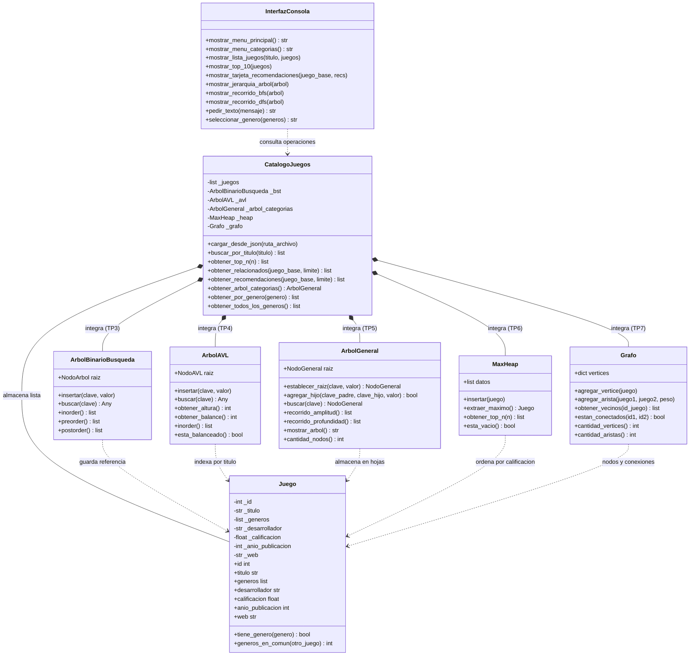

# Diagrama de Clases — NextGame
**Materia:** Estructuras de Datos — Universidad Nacional Guillermo Brown (UNAB)  
**Proyecto:** NextGame - Sistema de Recomendación de Videojuegos  
**Integrantes:** Hernandez Alejo, Mora Joaquín  

---

## 1. Descripción de la Arquitectura
El sistema está diseñado bajo el paradigma de Programación Orientada a Objetos (POO) con separación de responsabilidades:
- **`modelos/`**: Modela la entidad principal de dominio (`Juego`) con encapsulamiento de atributos privados y propiedades públicas.
- **`estructuras/`**: Contiene las estructuras de datos implementadas manualmente para la materia (BST, AVL, Árbol General, Max-Heap y Grafo).
- **`servicios/`**: `CatalogoJuegos` actúa como clase controladora central; compone y coordina todas las estructuras de datos sobre el conjunto de juegos.
- **`interfaz/`**: `InterfazConsola` desacopla la presentación en terminal de la lógica de negocio.

---

## 2. Diagrama Gráfico Renderizado

---

## 3. Especificación en Código Mermaid

