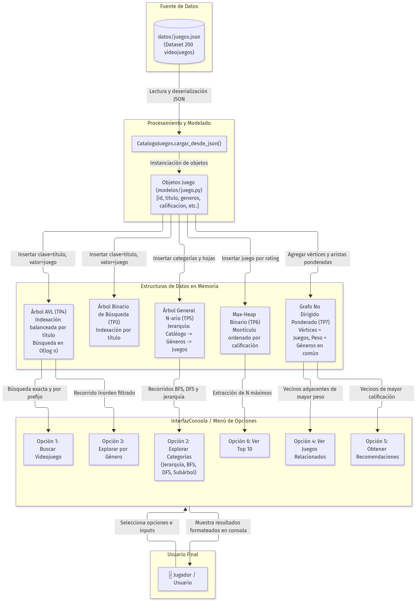
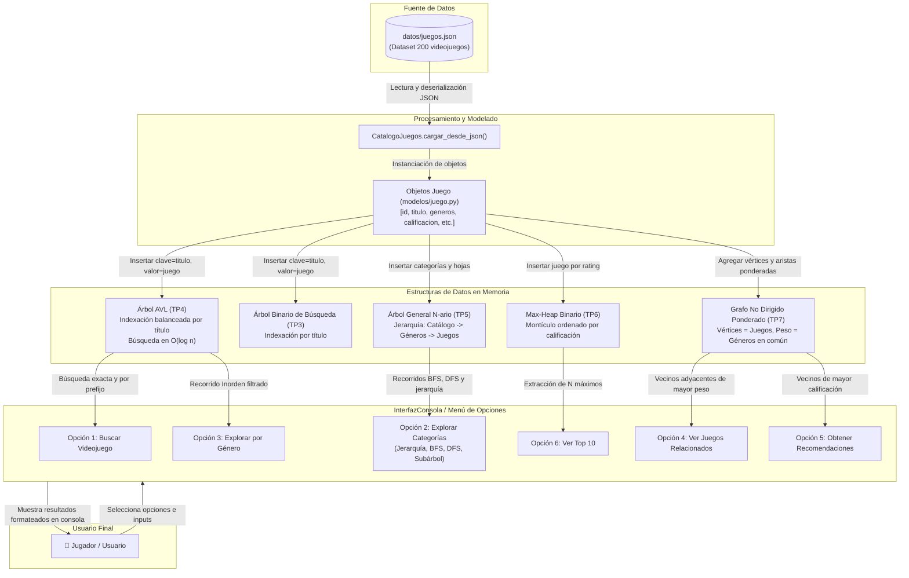

# Diagrama de Datos y Conexión de Estructuras — NextGame
**Materia:** Estructuras de Datos — Universidad Nacional Guillermo Brown (UNAB)  
**Proyecto:** NextGame - Sistema de Recomendación de Videojuegos  
**Integrantes:** Hernandez Alejo, Mora Joaquín  

---

## 1. Descripción del Flujo de Datos
El diagrama modela el ciclo de vida de la información en NextGame:
1. **Fuente de Datos:** Se leen 200 videojuegos estructurados en formato JSON desde `datos/juegos.json`.
2. **Carga y Deserialización:** `CatalogoJuegos.cargar_desde_json()` parsea los registros e instancia los objetos de dominio `Juego` (`modelos/juego.py`).
3. **Distribución en Estructuras de Memoria:**
   - **Árbol AVL (TP4):** Indexación balanceada por título para búsquedas rápidas en tiempo logarítmico $O(\log n)$.
   - **Árbol Binario de Búsqueda (TP3):** Estructura previa de indexación binaria por título.
   - **Árbol General N-ario (TP5):** Estructura jerárquica multinivel: Raíz ("Catálogo NextGame") $\rightarrow$ Categorías/Géneros $\rightarrow$ Videojuegos en hojas.
   - **Max-Heap Binario (TP6):** Montículo de máximos ordenado por calificación para resolver eficientemente el Top 10 sin necesidad de ordenar la totalidad del dataset.
   - **Grafo No Dirigido Ponderado (TP7):** Red de videojuegos interconectados donde los vértices representan juegos y las aristas están ponderadas según la cantidad de géneros compartidos.
4. **Conexión con el Menú e Interacción con el Usuario:** Cada opción del menú principal en `InterfazConsola` consulta la estructura especializada adecuada y muestra los resultados formateados en la terminal.

---

## 2. Diagrama Gráfico Renderizado

---

## 3. Especificación en Código Mermaid

